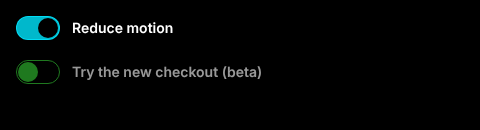
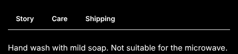
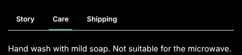
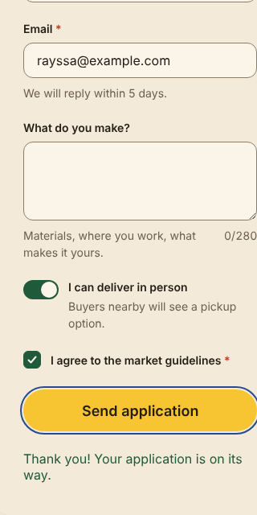
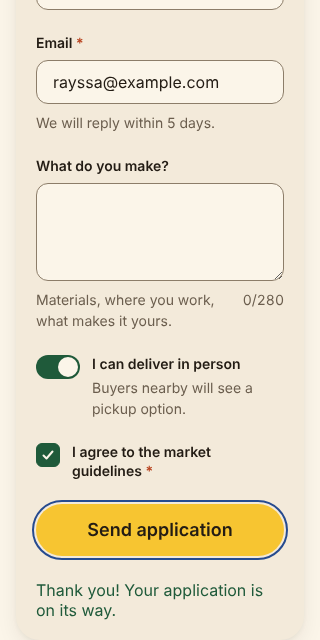

# Bug reports · Ipê Design System 1.0.0

Found during the 1.0 QA cycle ([test plan](./TEST-PLAN.md)). All six are fixed in **1.0.1**. Each one is also filed as a GitHub issue with the _Bug report_ template.

| ID                      | Title                                                        | Severity | Priority | WCAG 2.2                     | Status |
| ----------------------- | ------------------------------------------------------------ | -------- | -------- | ---------------------------- | ------ |
| [IPE-QA-01](#ipe-qa-01) | Switch disappears in Windows High Contrast                   | High     | P1       | 1.4.11 Non-text Contrast     | Fixed  |
| [IPE-QA-02](#ipe-qa-02) | Selected tab looks like the others in High Contrast          | Medium   | P1       | 1.4.11, 1.3.1                | Fixed  |
| [IPE-QA-03](#ipe-qa-03) | Textarea counter is read as "9/280" with no context          | Medium   | P2       | 1.3.1 Info and Relationships | Fixed  |
| [IPE-QA-04](#ipe-qa-04) | Maker sign-up pattern scrolls sideways at 320px              | Medium   | P2       | 1.4.10 Reflow                | Fixed  |
| [IPE-QA-05](#ipe-qa-05) | Checkbox box is 22 × 22 px, below the 24px target size       | Low      | P3       | 2.5.8 Target Size (Minimum)  | Fixed  |
| [IPE-QA-06](#ipe-qa-06) | Button _Sizes_ and _States_ stories scroll sideways at 320px | Low      | P3       | 1.4.10 Reflow (docs only)    | Fixed  |

---

## IPE-QA-01

**Switch disappears in Windows High Contrast**

- **Component:** Switch
- **Severity:** High. People who use High Contrast cannot see the control or whether it is on.
- **Environment:** Chromium 1.64 (Playwright), `forced-colors: active`, `prefers-color-scheme: dark`, Storybook `Components/Switch/States`, Ipê 1.0.0

**Steps to reproduce**

1. Open _Components → Switch → States_.
2. Turn on Windows High Contrast (or in Chrome DevTools: Rendering → Emulate CSS media feature `forced-colors: active`).

**Expected:** the track, the thumb and the on/off state are visible.

**Actual:** only the labels are visible. The track and the thumb are drawn with `background` only, and forced colors replace backgrounds with the page color.

| Before (1.0.0)                                               | After (1.0.1)                                              |
| ------------------------------------------------------------ | ---------------------------------------------------------- |
|  |  |

**Root cause:** state communicated by background color only.

**Fix:** a `@media (forced-colors: active)` block draws the track border with `ButtonText`, the thumb with `ButtonText`, and the "on" state with `Highlight` / `HighlightText`. System colors follow whatever theme the user picked.

**Regression check:** TC-14 (manual, forced colors).

---

## IPE-QA-02

**Selected tab looks like the others in High Contrast**

- **Component:** Tabs
- **Severity:** Medium. The selected tab is still announced by screen readers, but sighted High Contrast users lose the visual cue once focus leaves the tab list.
- **Environment:** same as IPE-QA-01, Storybook `Components/Tabs/Default`

**Steps to reproduce**

1. Open _Components → Tabs → Default_ with forced colors on.
2. Click outside the tabs so none of them has focus.

**Expected:** the selected tab is visibly different.

**Actual:** all tabs look the same. The indicator is a `::after` with a background color, which forced colors remove.

| Before (1.0.0)                                           | After (1.0.1)                                          |
| -------------------------------------------------------- | ------------------------------------------------------ |
|  |  |

**Fix:** in forced colors, the indicator uses `forced-color-adjust: none` and `Highlight`.

**Regression check:** TC-15 (manual, forced colors).

---

## IPE-QA-03

**Textarea counter is read as "9/280" with no context**

- **Component:** Textarea (`showCount`)
- **Severity:** Medium. Screen reader users hear "9 slash 280" with no idea it is a character limit.
- **Environment:** accessible description computed in Chromium, Storybook `Components/Textarea/Playground`

**Steps to reproduce**

1. Type "Obrigada!" in the Playground textarea.
2. Inspect the accessible description (DevTools → Accessibility) or listen with NVDA.

**Expected:** "…Makers love hearing from you. 9 of 280 characters".

**Actual:** "…Makers love hearing from you. 9/280".

**Fix:** the visible "9/280" is now `aria-hidden`. A visually hidden text, referenced by `aria-describedby`, reads "9 of 280 characters". A new `formatCount(length, maxLength)` prop lets apps translate it, for example `"9 de 280 caracteres"`.

**Regression check:** TC-22, automated in `Textarea.test.tsx` and in the Playground story `play` function (light and dark, CI).

---

## IPE-QA-04

**Maker sign-up pattern scrolls sideways at 320px**

- **Component:** Patterns → Maker sign-up (documentation pattern that teams copy)
- **Severity:** Medium. At 400% zoom on a 1280px screen, people must scroll in two directions to fill the form.
- **Environment:** Chromium, viewport 320 × 640

**Steps to reproduce**

1. Open _Patterns → Maker sign-up_ at 320px wide.
2. Run `document.documentElement.scrollWidth` in the console.

**Expected:** 320 (no horizontal scroll).

**Actual:** 387. The form uses `width: min(100%, 520px)` with `padding: 40px` and the default `box-sizing: content-box`, so the padding is added on top of 100%.

| Before (1.0.0)                                        | After (1.0.1)                                       |
| ----------------------------------------------------- | --------------------------------------------------- |
|  |  |

**Fix:** `box-sizing: border-box` and `padding: clamp(20px, 6vw, 40px)`.

**Regression check:** TC-18 (manual reflow check, `scrollWidth` = 320).

---

## IPE-QA-05

**Checkbox box is 22 × 22 px, below the 24px target size**

- **Component:** Checkbox
- **Severity:** Low. WCAG 2.5.8 still passes because the label is clickable and adds spacing, but the box alone is under the minimum. A checkbox used without a visible label would fail.
- **Environment:** Chromium, `getBoundingClientRect()` on `role="checkbox"`

**Expected:** at least 24 × 24 CSS px.

**Actual:** 22 × 22.

**Fix:** the box is now 24 × 24. The row alignment was adjusted so the label stays centered.

**Regression check:** TC-20, automated in the Checkbox Playground story. It fails if the box is set back to 22px (verified).

---

## IPE-QA-06

**Button _Sizes_ and _States_ stories scroll sideways at 320px**

- **Component:** Button stories (documentation only, the component itself is fine)
- **Severity:** Low
- **Steps:** open _Components → Button → Sizes_ at 320px wide.
- **Expected:** buttons wrap to a new line.
- **Actual:** `scrollWidth` 355. The story wrapper is a flex row without `flex-wrap`.
- **Fix:** `flex-wrap: wrap` on the story wrappers.
- **Regression check:** TC-19 (manual reflow check).
